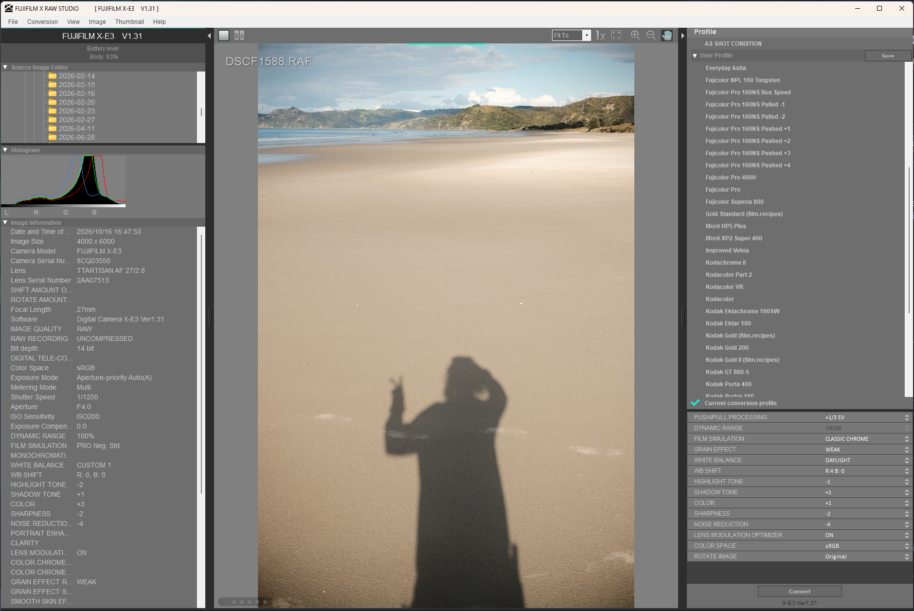

# Fujifilm X-Trans III Film Simulation Profiles for X Raw Studio

A collection of **59 Film Simulation Profiles** (`.FP1`) for **Fujifilm X Raw Studio**, ready to convert and install for any camera powered by the **Fujifilm X-Trans CMOS III** sensor and X-Processor Pro engine.

Includes the full library from **[Fuji X Weekly](https://fujixweekly.com/)** and **[film.recipes](https://film.recipes/)**, including the complete **Kodak Gold** suite, Kodacolor classics, Portra, Kodachrome, and Acros/Monochrome black-and-white stocks.



---

## 📷 Supported Cameras

All 59 profiles are strictly verified and calibrated for the hardware capabilities of Fujifilm's 3rd-generation X-Trans system:

* **Fujifilm X-E3**
* **Fujifilm X-T2**
* **Fujifilm X-T20**
* **Fujifilm X-Pro2**
* **Fujifilm X100F**
* **Fujifilm X-H1**

*(All models share the 24.3 MP X-Trans III sensor, standard grain, integer highlight/shadow tone curves from -2 to +4, and the classic film simulations Provia, Velvia, Astia, Classic Chrome, PRO Neg. Hi, PRO Neg. Std, and Acros).*

---

## 💡 Why Do These Profiles Need Conversion?

Fujifilm X Raw Studio requires each `.FP1` profile to match the connected camera's exact identification metadata:
* **Camera Model:** e.g., `device="X-E3"` or `device="X-T2"`
* **Condition Code:** e.g., `version="X-E3_0100"`
* **Camera Serial Number:** A hex-encoded identifier unique to each camera body (`<SerialNumber>`)
* **Firmware Struct & IOP Codes:** Internal engine compatibility tags (`<StructVer>`, `<IOPCode>`)

Without this metadata matching your physical camera, X Raw Studio will not display or apply the profiles. This repository supplies the generic templates and an automated converter (`fx-templater.py`) that extracts this information from one master file and stamps all 59 profiles for your camera in seconds.

---

## 🚀 Quick Start Guide

### 1. Export a Master Profile from X Raw Studio
1. Connect your Fujifilm camera to your computer via USB (Camera menu: *SET UP* > *CONNECTION SETTING* > *PC CONNECTION MODE* > *USB RAW CONV./BACKUP RESTORE*).
2. Open **Fujifilm X Raw Studio**.
3. Select any RAW (`.RAF`) photo.
4. On the right-hand panel under **User Profile**, click **Save** (or change any setting and save) to create a profile (e.g. `MyMaster.FP1`).

> **Where are profiles saved?**
> * **Windows:** `%LOCALAPPDATA%\com.fujifilm.denji\X_RAW_STUDIO\<CAMERA>\<FIRMWARE>\`
> * **macOS:** `~/Library/Application Support/com.fujifilm.denji/X_RAW_STUDIO/<CAMERA>/<FIRMWARE>/`

---

### 2. Convert and Install Profiles

Clone or download this repository, open a terminal in the repository folder, and run:

```bash
# Option A: Convert and directly install to X Raw Studio (recommended)
python fx-templater.py "path/to/your/MyMaster.FP1" --install

# Option B: Auto-detect your saved profile from X Raw Studio and install
python fx-templater.py --auto --install

# Option C: Convert to a local folder without installing
python fx-templater.py "path/to/your/MyMaster.FP1" --output-dir "./my_profiles"
```

### 3. Open X Raw Studio
Restart or open **Fujifilm X Raw Studio**. All 59 profiles will appear immediately in your **User Profile** dropdown list. You can apply them in batch or copy your favorites into your camera's custom presets (**C1–C7**)!

---

## ⚙️ Converter Options (`fx-templater.py`)

| Flag | Description |
| :--- | :--- |
| `master_template` | Path to your reference `.FP1` profile exported from X Raw Studio. |
| `--auto` | Automatically scans your system's X Raw Studio folder to find an existing `.FP1` profile. |
| `--install` | Automatically copies the stamped profiles directly into your local X Raw Studio user folder. |
| `--output-dir`, `-o` | Target directory for converted files (defaults to `./converted`). |
| `--input-dir`, `-i` | Directory containing source templates (defaults to `./Fuji X Weekly Recipes/X-Trans III`). |
| `--zero-exposure-bias` | Forces all profiles to `<ExposureBias>0</ExposureBias>` if you prefer to meter exposures manually. |

---

## 📁 Repository Structure

```text
├── .gitignore
├── LICENSE                                     # MIT License
├── README.md                                   # This documentation
├── fx-templater.py                             # Root conversion & installation utility
├── src/
│   ├── build_profiles.py                       # Template generator & scraper
│   ├── fx-templater.py                         # Module copy of converter
│   └── validate_profiles.py                    # Schema & hardware validation test suite
└── Fuji X Weekly Recipes/
    └── X-Trans III/
        ├── fx-templater.py                     # Converter script inside template directory
        ├── 123 Chrome (film.recipes).FP1       # Generic .FP1 templates (59 total)
        ├── Acros.FP1
        ├── Kodak Gold 200.FP1
        ├── Kodak Gold II (film.recipes).FP1
        └── ...
```

---

## 📋 Catalog of the 59 Film Simulation Profiles

### Base Collection from Fuji X Weekly (47 Profiles)

| # | Profile Name | Base Sim | Dynamic Range | Grain | White Balance | Color Temp | WB Shift (R/B) | Source URL |
| :- | :--- | :--- | :-: | :---: | :--- | :---: | :---: | :--- |
| 1 | `Velvia` | `Velvia` | `200` | `WEAK` | `Auto` | `0K` | `+1 / -1` | [Fuji X Weekly](https://fujixweekly.com/2017/10/01/my-fujifilm-x100f-velvia-film-simulation-recipe/) |
| 2 | `Improved Velvia` | `Velvia` | `200` | `WEAK` | `Auto` | `0K` | `-1 / -2` | [Fuji X Weekly](https://fujixweekly.com/2022/02/25/fujifilm-x-h1-x-trans-iii-x-t3-x-30-film-simulation-recipe-improved-velvia/) |
| 3 | `Astia` | `Astia` | `200` | `WEAK` | `Auto` | `0K` | `0 / 0` | [Fuji X Weekly](https://fujixweekly.com/2017/10/16/my-fujifilm-x100f-astia-film-simulation-recipe/) |
| 4 | `Everyday Astia` | `Astia` | `400` | `WEAK` | `Auto` | `0K` | `-1 / -2` | [Fuji X Weekly](https://fujixweekly.com/2022/09/21/fujifilm-x-h1-x-trans-iii-x-t3-x-t30-film-simulation-recipe-everyday-astia/) |
| 5 | `Provia Slide` | `Provia` | `200` | `WEAK` | `FLight3` | `0K` | `-1 / -8` | [Fuji X Weekly](https://fujixweekly.com/2024/04/15/provia-slide-fujifilm-x-pro2-x-trans-iii-film-simulation-recipe/) |
| 6 | `Classic Chrome` | `Classic` | `200` | `WEAK` | `Auto` | `0K` | `+1 / -1` | [Fuji X Weekly](https://fujixweekly.com/2017/08/27/my-fujifilm-x100f-classic-chrome-film-simulation-recipe/) |
| 7 | `Vintage Kodachrome` | `Classic` | `200` | `STRONG` | `Auto` | `0K` | `+2 / -4` | [Fuji X Weekly](https://fujixweekly.com/2017/10/21/my-fujifilm-x100f-vintage-kodachrome-film-simulation-recipe/) |
| 8 | `Vintage Kodacolor` | `Classic` | `200` | `STRONG` | `Temperature` | `9100K` | `-4 / +4` | [Fuji X Weekly](https://fujixweekly.com/2022/08/29/fujifilm-x-trans-iii-x-t3-x-t30-film-simulation-recipe-vintage-kodacolor/) |
| 9 | `Mystery Chrome` | `Classic` | `400` | `STRONG` | `Daylight` | `0K` | `+3 / -5` | [Fuji X Weekly](https://fujixweekly.com/2022/12/09/fujifilm-x-trans-iii-x-t3-x-t30-film-simulation-recipe-mystery-chrome/) |
| 10 | `PRO Neg. Hi` | `NEGAhi` | `200` | `WEAK` | `Auto` | `0K` | `0 / 0` | [Fuji X Weekly](https://fujixweekly.com/2018/01/21/my-fujifilm-x100f-pro-neg-hi-film-simulation-recipe-portraits/) |
| 11 | `Fujicolor Pro 160NS Box Speed` | `NEGAhi` | `400` | `WEAK` | `Daylight` | `0K` | `0 / 0` | [Fuji X Weekly](https://fujixweekly.com/2021/05/24/a-different-approach-7-new-fujicolor-pro-160ns-film-simulation-recipes-yes-7/) |
| 12 | `Fujicolor Pro 160NS Pulled -1` | `NEGAhi` | `400` | `WEAK` | `Daylight` | `0K` | `0 / 0` | [Fuji X Weekly](https://fujixweekly.com/2021/05/24/a-different-approach-7-new-fujicolor-pro-160ns-film-simulation-recipes-yes-7/) |
| 13 | `Fujicolor Pro 160NS Pulled -2` | `NEGAhi` | `400` | `WEAK` | `Daylight` | `0K` | `0 / 0` | [Fuji X Weekly](https://fujixweekly.com/2021/05/24/a-different-approach-7-new-fujicolor-pro-160ns-film-simulation-recipes-yes-7/) |
| 14 | `Fujicolor Pro 160NS Pushed +1` | `NEGAhi` | `400` | `WEAK` | `Daylight` | `0K` | `0 / 0` | [Fuji X Weekly](https://fujixweekly.com/2021/05/24/a-different-approach-7-new-fujicolor-pro-160ns-film-simulation-recipes-yes-7/) |
| 15 | `Fujicolor Pro 160NS Pushed +2` | `NEGAhi` | `400` | `WEAK` | `Daylight` | `0K` | `0 / 0` | [Fuji X Weekly](https://fujixweekly.com/2021/05/24/a-different-approach-7-new-fujicolor-pro-160ns-film-simulation-recipes-yes-7/) |
| 16 | `Fujicolor Pro 160NS Pushed +3` | `NEGAhi` | `400` | `WEAK` | `Daylight` | `0K` | `0 / 0` | [Fuji X Weekly](https://fujixweekly.com/2021/05/24/a-different-approach-7-new-fujicolor-pro-160ns-film-simulation-recipes-yes-7/) |
| 17 | `Fujicolor Pro 160NS Pushed +4` | `NEGAhi` | `400` | `WEAK` | `Daylight` | `0K` | `0 / 0` | [Fuji X Weekly](https://fujixweekly.com/2021/05/24/a-different-approach-7-new-fujicolor-pro-160ns-film-simulation-recipes-yes-7/) |
| 18 | `Fujicolor Superia 800` | `NEGAStd` | `200` | `STRONG` | `Auto` | `0K` | `-2 / -3` | [Fuji X Weekly](https://fujixweekly.com/2018/02/03/my-fujifilm-x100f-fujicolor-superia-800-film-simulation-recipe-pro-neg-std/) |
| 19 | `CineStill 800T` | `NEGAStd` | `200` | `STRONG` | `Temperature` | `3200K` | `0 / 0` | [Fuji X Weekly](https://fujixweekly.com/2018/04/25/my-fujifilm-x100f-cinestill-800t-film-simulation-recipe/) |
| 20 | `Fujicolor NPL 160 Tungsten` | `NEGAStd` | `400` | `WEAK` | `FLight3` | `0K` | `-6 / -3` | [Fuji X Weekly](https://fujixweekly.com/2021/12/06/fujifilm-x-h1-x-trans-iii-film-simulation-recipe-fujicolor-npl-160-tungsten/) |
| 21 | `Eterna (X100F)` | `NEGAStd` | `400` | `WEAK` | `Auto` | `0K` | `+2 / +2` | [Fuji X Weekly](https://fujixweekly.com/2018/03/02/my-fujifilm-x100f-eterna-film-simulation-recipe/) |
| 22 | `Eterna` | `NEGAStd` | `200` | `STRONG` | `Auto` | `0K` | `+5 / -6` | [Fuji X Weekly](https://fujixweekly.com/2019/04/13/my-x-t30-eterna-recipe-for-x-trans-iii/) |
| 23 | `Kodak Porta 400` | `Classic` | `400` | `STRONG` | `Custom1` | `0K` | `+2 / -5` | [Fuji X Weekly](https://fujixweekly.com/2018/05/30/my-fujifilm-x100f-kodak-portra-400-film-simulation-recipe/) |
| 24 | `Kodak Ektar 100` | `Astia` | `100` | `OFF` | `Auto` | `0K` | `+3 / -2` | [Fuji X Weekly](https://fujixweekly.com/2018/06/16/my-fujifilm-x100f-kodak-ektar-100-film-simulation-recipe/) |
| 25 | `Kodachrome II` | `Classic` | `200` | `WEAK` | `Auto` | `0K` | `+3 / -4` | [Fuji X Weekly](https://fujixweekly.com/2018/08/19/my-fujifilm-x-pro2-kodachrome-ii-film-simulation-recipe/) |
| 26 | `Dramatic Classic Chrome` | `Classic` | `100` | `STRONG` | `Auto` | `0K` | `-1 / +1` | [Fuji X Weekly](https://fujixweekly.com/2018/05/22/my-fujifilm-x-pro2-dramatic-classic-chrome-film-simulation-recipe/) |
| 27 | `Vintage Agfacolor` | `Classic` | `100` | `STRONG` | `Auto` | `0K` | `-3 / -4` | [Fuji X Weekly](https://fujixweekly.com/2018/06/23/my-fujifilm-x-pro2-vintage-agfacolor-film-simulation-recipe/) |
| 28 | `Melancholy Blue` | `Classic` | `200` | `WEAK` | `Incand` | `0K` | `+4 / -9` | [Fuji X Weekly](https://fujixweekly.com/2022/08/08/fujifilm-x-trans-iii-x-t3-x-t30-film-simulation-recipe-melancholy-blue/) |
| 29 | `Nostalgic Emulsion` | `Classic` | `200` | `STRONG` | `UWater` | `0K` | `-6 / +3` | [Fuji X Weekly](https://fujixweekly.com/2024/10/24/nostalgic-emulsion-fujifilm-x-trans-iii-plus-x-t3-x-t30-film-simulation-recipe/) |
| 30 | `Aged Color` | `NEGAStd` | `400` | `STRONG` | `Auto` | `0K` | `+5 / -3` | [Fuji X Weekly](https://fujixweekly.com/2018/11/17/my-fujifilm-x-t20-aged-color-film-simulation-recipe/) |
| 31 | `Kodak Ektachrome 100SW` | `Velvia` | `200` | `WEAK` | `Auto` | `0K` | `+3 / -4` | [Fuji X Weekly](https://fujixweekly.com/2018/12/02/my-fujifilm-x-t20-kodak-ektachrome-100sw-film-simulation-recipe/) |
| 32 | `Ektachrome E100GX` | `Classic` | `200` | `WEAK` | `FLight2` | `0K` | `-1 / -6` | [Fuji X Weekly](https://fujixweekly.com/2022/07/26/fujifilm-x-trans-iii-x-t3-x-t30-film-simulation-recipe-ektachrome-e100gx/) |
| 33 | `Fujicolor Pro 400H` | `NEGAStd` | `200` | `WEAK` | `Auto` | `0K` | `+2 / +1` | [Fuji X Weekly](https://fujixweekly.com/2018/12/23/my-fujifilm-x-t20-fujicolor-pro-400h-film-simulation-recipe/) |
| 34 | `Fujicolor Pro` | `NEGAStd` | `400` | `STRONG` | `Temperature` | `5900K` | `-2 / 0` | [Fuji X Weekly](https://fujixweekly.com/2023/05/08/fujicolor-pro-fujifilm-x-trans-iii-x-t3-x-t30-film-simulation-recipe/) |
| 35 | `Agfa Optima` | `Provia` | `100` | `WEAK` | `Auto` | `0K` | `-1 / -1` | [Fuji X Weekly](https://fujixweekly.com/2019/02/14/fujifilm-provia-film-simulation-settings-or-my-agfa-optima-200-recipe/) |
| 36 | `Classic Negative` | `NEGAStd` | `400` | `WEAK` | `Temperature` | `6700K` | `-2 / +7` | [Fuji X Weekly](https://fujixweekly.com/2019/11/07/my-fujifilm-classic-negative-film-simulation-recipe-for-x-trans-iii/) |
| 37 | `Kodak Ultramax` | `Classic` | `400` | `STRONG` | `Auto` | `0K` | `+1 / -6` | [Fuji X Weekly](https://fujixweekly.com/2020/08/24/fujifilm-x-t20-x-trans-iii-x-t30-film-simulation-recipe-kodak-ultramax/) |
| 38 | `Kodak GT 800-5` | `NEGAStd` | `400` | `STRONG` | `Temperature` | `7100K` | `+7 / -5` | [Fuji X Weekly](https://fujixweekly.com/2022/01/11/fujifilm-x-h1-film-simulation-recipe-kodak-gt-800-5/) |
| 39 | `Cine Teal` | `NEGAStd` | `400` | `WEAK` | `Temperature` | `4500K` | `+2 / -8` | [Fuji X Weekly](https://fujixweekly.com/2020/06/25/fujifilm-x-t20-x-trans-iii-film-simulation-recipe-cine-teal/) |
| 40 | `Cross Process` | `Provia` | `200` | `STRONG` | `Auto` | `0K` | `-3 / -8` | [Fuji X Weekly](https://fujixweekly.com/2018/10/15/my-fujifilm-x100f-cross-process-film-simulation-recipe/) |
| 41 | `Acros` | `Acros` | `200` | `OFF` | `Auto` | `0K` | `0 / 0` | [Fuji X Weekly](https://fujixweekly.com/2017/08/27/my-fujifilm-x100f-acros-film-simulation-recipe/) |
| 42 | `Acros Push Process` | `Acros` | `200` | `STRONG` | `Auto` | `0K` | `0 / 0` | [Fuji X Weekly](https://fujixweekly.com/2017/11/11/my-fujifilm-x100f-acros-push-process-film-simulation-recipe/) |
| 43 | `Agfa Scala` | `Acros` | `100` | `WEAK` | `Auto` | `0K` | `0 / 0` | [Fuji X Weekly](https://fujixweekly.com/2018/08/12/my-fujifilm-x100f-agfa-scala-film-simulation-recipe/) |
| 44 | `Ilford HP5 Plus` | `Acros` | `200` | `STRONG` | `Auto` | `0K` | `0 / 0` | [Fuji X Weekly](https://fujixweekly.com/2018/12/01/my-fujifilm-x100f-ilford-hp5-plus-film-simulation-recipe/) |
| 45 | `Ilford XP2 Super 400` | `AcrosR` | `400` | `STRONG` | `Temperature` | `10000K` | `+7 / +7` | [Fuji X Weekly](https://fujixweekly.com/2021/12/11/fujifilm-x-h1-x-trans-iii-film-simulation-recipe-ilford-xp2-super-400/) |
| 46 | `Analog Monochrome` | `AcrosG` | `400` | `WEAK` | `Incand` | `0K` | `-8 / -8` | [Fuji X Weekly](https://fujixweekly.com/2022/01/05/fujifilm-x-h1-x-trans-iii-x-t3-x-t30-film-simulation-recipe-analog-monochrome/) |
| 47 | `Kodak Tri-X Push Process` | `Acros` | `200` | `OFF` | `Auto` | `0K` | `0 / 0` | [Fuji X Weekly](https://fujixweekly.com/2018/08/25/not-my-fujifilm-x-pro2-tri-x-push-process-film-simulation-recipe/) |

---

### Extended Kodak & Community Collection (12 Profiles)

| # | Profile Name | Base Sim | Dynamic Range | Grain | White Balance | Color Temp | WB Shift (R/B) | Source URL |
| :- | :--- | :--- | :-: | :---: | :--- | :---: | :---: | :--- |
| 48 | `Kodak Gold 200` | `Classic` | `200` | `STRONG` | `Daylight` | `0K` | `+4 / -5` | [Fuji X Weekly](https://fujixweekly.com/2020/04/16/my-fujifilm-x-t30-kodak-gold-200-film-simulation-recipe/) |
| 49 | `Classic Kodak` | `Classic` | `400` | `STRONG` | `Shade` | `0K` | `-1 / +2` | [Fuji X Weekly](https://fujixweekly.com/2022/11/08/fujifilm-x-t30-x-t3-x-trans-iii-film-simulation-recipe-classic-kodak/) |
| 50 | `Kodacolor` | `Classic` | `400` | `STRONG` | `Temperature` | `6300K` | `-1 / -4` | [Fuji X Weekly](https://fujixweekly.com/2019/07/19/my-fujifilm-x-t30-kodacolor-film-simulation-recipe/) |
| 51 | `Kodacolor Part 2` | `Classic` | `400` | `STRONG` | `Temperature` | `6300K` | `-1 / -4` | [Fuji X Weekly](http://fujixweekly.com/2020/03/16/kodacolor-film-simulation-recipe-part-2/) |
| 52 | `Kodacolor VR` | `Classic` | `400` | `WEAK` | `Temperature` | `10000K` | `-7 / +8` | [Fuji X Weekly](https://fujixweekly.com/2022/04/11/fujifilm-x-trans-iii-x-t3-x-t30-film-simulation-recipe-kodacolor-vr/) |
| 53 | `Kodak Portra 160` | `Classic` | `200` | `WEAK` | `Daylight` | `0K` | `+4 / -5` | [Fuji X Weekly](https://fujixweekly.com/2020/04/03/my-fujifilm-x-t30-kodak-portra-160-film-simulation-recipe/) |
| 54 | `Kodak Gold (film.recipes)` | `Classic` | `200` | `STRONG` | `Daylight` | `0K` | `+4 / -5` | [film.recipes](https://film.recipes/2022/04/22/kodak-gold-film-recipe-for-nostalgic-warmth/) |
| 55 | `Kodak Gold II (film.recipes)` | `Classic` | `200` | `WEAK` | `Daylight` | `0K` | `+4 / -5` | [film.recipes](https://film.recipes/2026/07/19/kodak-gold-ii-classic-kodak-film-recipe/) |
| 56 | `Old Gold (film.recipes)` | `Classic` | `200` | `WEAK` | `Daylight` | `0K` | `+4 / -7` | [film.recipes](https://film.recipes/2026/05/28/old-gold-film-recipe/) |
| 57 | `Gold Standard (film.recipes)` | `NEGAStd` | `200` | `WEAK` | `Daylight` | `0K` | `+4 / -5` | [film.recipes](https://film.recipes/2022/06/14/gold-standard-for-an-everyday-kodak-gold/) |
| 58 | `Rescued Colorplus (film.recipes)` | `Classic` | `400` | `WEAK` | `Auto` | `0K` | `+2 / -4` | [film.recipes](https://film.recipes/2023/09/01/rescued-colorplus-from-a-found-kodak-film/) |
| 59 | `123 Chrome (film.recipes)` | `Classic` | `400` | `OFF` | `UWater` | `0K` | `+1 / -2` | [film.recipes](https://film.recipes/2025/07/22/123-chrome-classic-kodachrome-look/) |

---

## 🛠️ Developer Verification Suite

If you add new recipes or modify settings, you can validate compliance against Fujifilm's `XRFC.dll` rules:

```bash
# Validate generic templates
python src/validate_profiles.py --templates

# Validate any directory of converted profiles
python src/validate_profiles.py "path/to/converted"
```

The test suite validates:
1. XML schema well-formedness and UTF-8 encoding.
2. Valid XRFC enum values for Film Simulation, White Balance, Dynamic Range, and Exposure Bias.
3. Allowed discrete Kelvin temperature steps (`2500K` through `10000K`).
4. Camera-level constraints (`ChromeEffect=OFF`, `GrainEffectSize=SMALL`, empty `ColorChromeBlue` & `SmoothSkinEffect`).

---

## ⚖️ Credits & Disclaimers

- Base recipes created by **Ritchie Roesch** at [Fuji X Weekly](https://fujixweekly.com/). Check out the [Fuji X Weekly App](https://fujixweekly.com/app/) for iOS and Android.
- Additional Kodak & community recipes created by **Justin Gould** at [film.recipes](https://film.recipes/).
- Template converter methodology inspired by **[plamf/fuji-x-weekly-simulation-profiles](https://github.com/plamf/fuji-x-weekly-simulation-profiles)**.
- All profiles are for personal use with Fujifilm cameras and Fujifilm X Raw Studio.

### Trademarks & Nominative Fair Use
- **Fujifilm**, **X-Trans**, **Provia**, **Velvia**, **Astia**, and **Acros** are registered trademarks of FUJIFILM Corporation.
- **Kodak**, **Kodachrome**, **Kodacolor**, **Portra**, **Ektar**, **Tri-X**, and **Gold** are registered trademarks of Eastman Kodak Company.
- **Ilford** and **HP5** are registered trademarks of Harman Technology Limited.
- **Agfa** and **Scala** are registered trademarks of Agfa-Gevaert Group.
- **CineStill** is a registered trademark of CineStill Inc.

All brand and film names used in this repository are referenced strictly for **nominative descriptive purposes** to identify the historical photographic film stocks being visually emulated. This open-source project is independent and is not affiliated with, sponsored by, or endorsed by FUJIFILM Corporation, Eastman Kodak Company, or any of the respective trademark holders.
